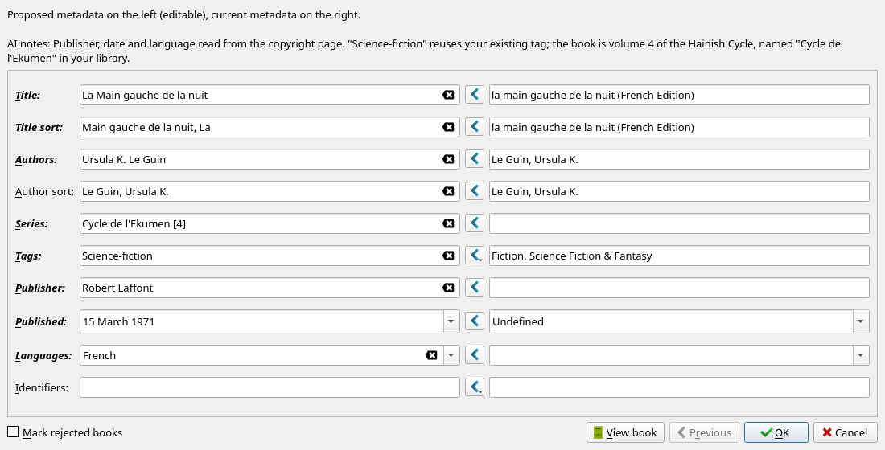
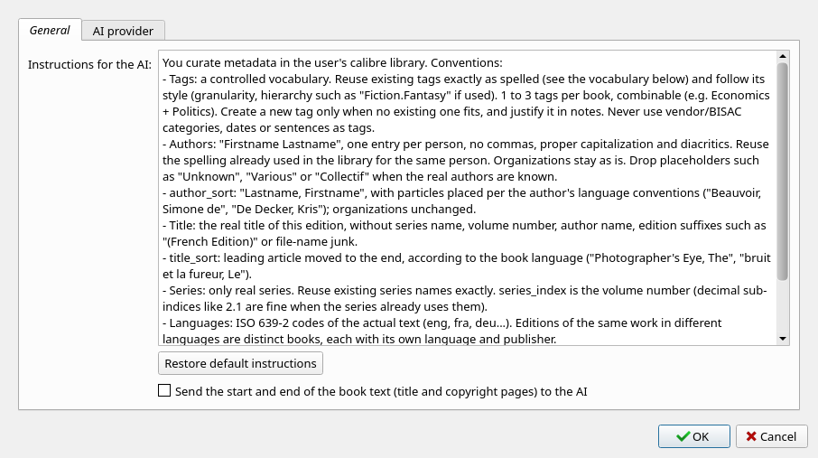

# AI metadata

A calibre plugin that asks the AI provider configured in calibre to rework the metadata and tags of the selected books, then shows the proposal in calibre's side-by-side review dialog before anything is saved.

It reviews title, title sort, authors, author sort, tags, series, publisher, publication date, languages and identifiers. The prompt includes your existing tags, series and authors, so the AI reuses your vocabulary instead of inventing a new one.

## Requirements

- calibre 9.0 or later
- An AI provider configured in calibre (OpenRouter, OpenAI, Anthropic, Google, Ollama, LM Studio…). The plugin reuses calibre's AI settings, the same ones as calibre's built-in AI features.

## Installation

Download `ai_metadata.zip` from the [latest release](https://github.com/olivierlemoal/calibre-ai-metadata/releases/latest), then in calibre: *Preferences → Plugins → Load plugin from file*, and restart calibre.

## Usage

Select books, then click **AI metadata** in the toolbar. The AI works in the background (see the Jobs panel); when it is done, review each book: proposed values on the left (editable), current values on the right. Nothing is written until you accept.



Books are sent in batches of 10; if a batch fails, the others are still reviewed and the books the AI could not handle are listed. Tags, series and publishers that differ from existing ones only by case are mapped to the existing spelling, so a proposal never renames an item library-wide.

## Settings

*Preferences → Plugins → AI metadata → Customize plugin*, or the arrow next to the toolbar button:

- **General**: the instructions sent to the AI (tagging and naming conventions). Edit them to match your library.
- **General → Send the start and end of the book text**: off by default. Sends the first ~4000 and last ~1500 characters of the EPUB, KEPUB, AZW3 or PDF file (title page, copyright page, colophon) so the AI can read the publisher, date and ISBN of your edition. Books are then sent in batches of 5. Files with DRM or without a text layer are sent without excerpt.
- **AI provider**: calibre's own AI configuration, shared with calibre's other AI features.



New tags follow the language of your existing tags, or calibre's interface language if the library has none. The AI notes follow calibre's "respond in the interface language" setting.

## Privacy

Each run sends the metadata of the selected books (title, authors, description, tags…) plus your library's tag, series and author names to the configured AI provider. With the excerpt option enabled, the start and end of each book's text are sent too.

## Development

```sh
./build.sh                     # build ai_metadata.zip
./build.sh --install           # build and install it into calibre
calibre-debug -e tests/run.py  # run the tests against the source tree
```

The build extracts translatable strings into `translations/messages.pot`, compiles the `.po` catalogs and packages the plugin. Translations: copy `translations/messages.pot` to `translations/<lang>.po` and translate it.

Releases: bump `version` in `__init__.py` and push to `main`. CI runs the tests, then publishes `v<version>` with the zip attached when no release exists for that version yet.

## License

GPL-3.0
